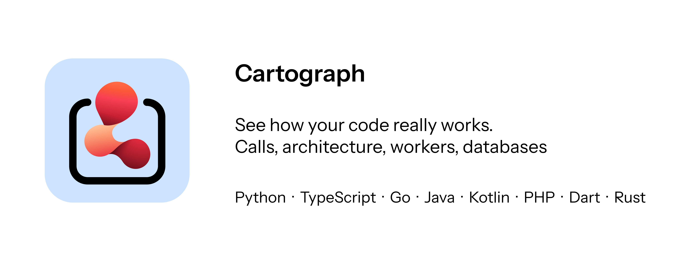

<p align="center"></p>

<p align="center">
  <a href="https://marketplace.visualstudio.com/items?itemName=drichdev.cartograph"></a>
  <a href="https://marketplace.visualstudio.com/items?itemName=drichdev.cartograph"></a>
  
  
</p>

 🇬🇧 English · 🇫🇷 Français version: [`README.md`](README.md)

# Cartograph

**Comprends un projet en un coup d'œil.** Cartograph dessine la carte de ton code dans VS Code : qui appelle quoi, comment les couches se parlent, et surtout **comment le projet fonctionne vraiment** (routes, files de tâches, workers, Redis, bases de données).

Il analyse **Python, TypeScript/JavaScript, Go, Java, Kotlin, PHP, Dart (Flutter) et Rust**, fusionne le tout, et relie même les appels `fetch` de ton front aux routes de ton back.

> Tout reste sur ta machine : aucune télémétrie, aucun envoi de code. Voir [Confidentialité](#confidentialité).

## Ce que tu obtiens

| Vue | À quoi elle sert |
|---|---|
| **Système** | Comment ça tourne : processus → routes → files (Celery, BullMQ…) → workers → Redis, MongoDB, SQL, APIs. Les envois asynchrones sont animés, les appels HTTP front → back sont reliés. |
| **Architecture** | Les modules rangés par couche (routes/UI → services → dépôts → modèles → infra). Une flèche rouge = dépendance qui remonte. Les imports circulaires sont signalés. |
| **Appels** | Le graphe d'appels. Un clic montre tout ce que la fonction déclenche **et** tout ce qui mène à elle. Double-clic = ouvre le code. |
| **Données** | Modèles (Pydantic, Beanie, SQLAlchemy, Prisma, Mongoose, TypeORM, JPA, Eloquent…), relations, base de stockage, et le **schéma réel** des bases comparé à ton code. |
| **Évolution** | Avant / après une refacto : fonctions ajoutées, supprimées, déplacées, nouvelles dépendances, routes, problèmes apparus ou résolus. |
| **Qualité** | Sécurité, erreurs, **code mort**, **doublons**, complexité, architecture. |

Et aussi : export **PNG / SVG / Mermaid**, interface en **français et anglais**, thème clair/sombre de VS Code respecté.

## Installation

- **Depuis VS Code** : ouvre l'onglet Extensions, cherche **Cartograph**, clique sur *Installer*.
- **Depuis un fichier** : `code --install-extension cartograph-0.1.0.vsix`
- **Depuis les sources** : voir [`CONTRIBUTING.md`](CONTRIBUTING.md).

Prérequis : VS Code ≥ 1.85. **Python ≥ 3.9** seulement si ton projet contient du Python (aucun paquet à installer). Rien d'autre.

## Démarrage en 30 secondes

1. Ouvre le dossier de ton projet.
2. `Ctrl+Maj+P` → **Cartograph : Ouvrir la carte du projet** (ou clique sur *Cartograph* dans la barre d'état).
3. Explore : clique sur un nœud pour voir ses détails, double-clique pour ouvrir le code, utilise la recherche en haut.

L'analyse se relance automatiquement à chaque sauvegarde.

## Langages et frameworks

| Langage | Analyse | Reconnu en plus |
|---|---|---|
| **Python** | AST | FastAPI (`Depends`, `Annotated`), Flask, Celery/RQ/Dramatiq, SQLAlchemy, Pydantic, Beanie |
| **TypeScript / JavaScript** | Compilateur TypeScript | Next.js (app + pages), Express/Fastify/Hono, NestJS (`@Module`, interfaces), React, BullMQ, Prisma, Mongoose, TypeORM, zod |
| **Go** | tree-sitter | gin/echo/chi/mux/fiber, gorm, mongo-driver, go-redis, asynq, cron, google/wire |
| **Java** | tree-sitter | Spring (`@RestController`, `@Bean`, `@Scheduled`, `@KafkaListener`, `@PreAuthorize`), JPA, Redis, JDBC |
| **Kotlin** | tree-sitter | Spring, Ktor (`get("/x") { }`), JPA, Room |
| **PHP** | tree-sitter | Laravel (routes, groupes, `Route::resource`, Eloquent, jobs), Symfony (`#[Route]`), Doctrine |
| **Dart / Flutter** | analyseur lexical léger¹ | widgets, `build`, GoRouter, Dio/http, sqflite, Hive, Firebase, Supabase |
| **Rust** | tree-sitter | axum, actix/rocket, sqlx/diesel, redis, reqwest, traits |

¹ Aucune grammaire tree-sitter Dart précompilée n'existe pour WebAssembly : Dart est analysé par un analyseur lexical (commentaires, chaînes, accolades) puis des motifs. Il est un peu moins précis que les autres.

## Ce qui est détecté

- **Code mort** : fonctions sans appelant. Routes, tâches, handlers, tests, cycles de vie des widgets sont exclus ; méthodes, fonctions décorées et exports publics sont marqués « peut-être ».
- **Doublons** : structure identique ou très similaire (≥ 85 %), quels que soient les noms de variables.
- **Sécurité** : exécution dynamique de code, commandes shell, SQL construit dynamiquement, secrets codés en dur, TLS désactivé, JWT non vérifié, CORS `*`, désérialisation non sûre, hash faibles, XSS, routes d'écriture sans authentification apparente.
- **Complexité** : cyclomatique par fonction, fonctions trop longues, trop d'arguments.
- **Infrastructure** : Redis, MongoDB, PostgreSQL, MySQL, SQLite, ORM, Celery, BullMQ, Asynq, RabbitMQ, Kafka, S3, Elasticsearch, LLM, SMTP, Stripe, Firebase, Supabase… + `docker-compose.yml` et `Procfile`.
- **Injection de dépendances** : FastAPI `Depends`, NestJS, Spring (`@Bean`), Go (`wire`), interfaces/traits : les appels indirects sont reliés aux implémentations (étiquette « injection »).

## Comparer avant / après une refacto

1. Onglet **Évolution** → **Enregistrer l'état actuel**.
2. Refactorise et enregistre : l'onglet liste les différences, et les fonctions concernées portent un badge *nouveau* / *modifié* dans la vue Appels.
3. Ou **Comparer avec Git…** : Cartograph analyse la révision choisie (HEAD, branche, tag, commit) dans un `git worktree` temporaire, sans toucher à ton dossier.

## Schéma réel des bases (optionnel)

- **SQLite** : les fichiers `.db` / `.sqlite` du projet sont lus automatiquement, en lecture seule.
- **PostgreSQL / MongoDB** : à activer toi-même avec `cartograph.databases` (lecture seule, 5 s de délai). Nécessite `psycopg2` (ou `psycopg`) / `pymongo` dans ton interpréteur Python.

```json
"cartograph.databases": [
  { "name": "prod", "type": "mongodb",  "uri": "${env:MONGO_URL}" },
  { "name": "app",  "type": "postgres", "uri": "${env:DATABASE_URL}" }
]
```

N'écris pas de mot de passe dans les réglages : `${env:NOM}` est lu dans tes variables d'environnement.

## Commandes

| Commande | Rôle |
|---|---|
| `Cartograph : Ouvrir la carte du projet` | Ouvre la carte. |
| `Cartograph : Actualiser l'analyse` | Relance l'analyse. |
| `Cartograph : Enregistrer l'état actuel comme référence` | Point de comparaison pour l'onglet Évolution. |
| `Cartograph : Comparer avec une révision Git…` | Compare avec HEAD, une branche, un tag ou un commit. |

## Réglages

| Réglage | Défaut | Rôle |
|---|---|---|
| `cartograph.language` | `auto` | Langue de l'interface : `auto` (suit VS Code), `fr` ou `en`. |
| `cartograph.pythonPath` | *(vide)* | Interpréteur Python ≥ 3.9. Vide = détection automatique. |
| `cartograph.exclude` | `[]` | Dossiers à ignorer en plus de `.venv`, `node_modules`, `target`, `vendor`, `build`… |
| `cartograph.autoRefresh` | `true` | Relancer l'analyse à l'enregistrement d'un fichier. |
| `cartograph.databases` | `[]` | Bases à lire pour afficher leur schéma réel. |

## Confidentialité

- **Aucune donnée ne quitte ta machine** : l'analyse est entièrement locale, l'extension ne fait aucune requête réseau et n'envoie aucune télémétrie.
- Les bases de données ne sont lues que si **tu** les déclares, en **lecture seule**. Les URI sont transmises à l'analyseur par variable d'environnement (jamais sur la ligne de commande) et les identifiants sont masqués à l'affichage.
- La comparaison Git utilise un `git worktree` temporaire, supprimé ensuite.
- Les caches sont stockés dans le dossier de stockage global de l'extension (jamais dans ton projet).

## Dépannage

**« Les fichiers Python n'ont pas pu être analysés »** — ouvre **Affichage → Sortie → Cartograph** : la vraie erreur y est. Causes fréquentes : Python introuvable ou < 3.9 (renseigne `cartograph.pythonPath`). Depuis la version 0.1.0, l'analyseur supprime et reconstruit tout seul son cache s'il est invalide, et ignore un fichier qui pose problème au lieu d'abandonner toute l'analyse.

**La carte est vide** — vérifie que le dossier contient du code d'un langage pris en charge, qu'il n'est pas dans `cartograph.exclude`, puis clique sur *Actualiser*.

**Trop de nœuds, c'est illisible** — utilise la recherche, ou « Mettre en avant » (code mort, sécurité…), ou décoche *Tests* / *Références*.

**Les liens front → back manquent** — ils nécessitent un chemin d'URL lisible (`fetch("/users/…")`). Les URL entièrement dynamiques ne sont pas reliées.

**L'export PNG/SVG est vide sur un très grand graphe** — utilise l'export Mermaid.

## Limites

- Les langages dynamiques ne se laissent pas analyser complètement : le graphe d'appels est une **approximation**. Les liens déduits d'un simple nom de méthode sont marqués « incertains » (pointillés, désactivables).
- Go / Java / Kotlin / PHP / Rust / Dart : la résolution repose sur les types déclarés, les champs, les paramètres et les imports, sans inférence complète.
- TypeScript : sans `node_modules`, les clients d'infra sont reconnus par leurs imports uniquement.

## Contribuer, publier

- Contribuer, ajouter un langage : [`CONTRIBUTING.md`](CONTRIBUTING.md), [`docs/ADD_A_LANGUAGE.md`](docs/ADD_A_LANGUAGE.md)
- Publier l'extension : [`docs/PUBLISHING.md`](docs/PUBLISHING.md)
- Historique des versions : [`CHANGELOG.md`](CHANGELOG.md) · Sécurité : [`SECURITY.md`](SECURITY.md)

## Licence

MIT © Drichdev

