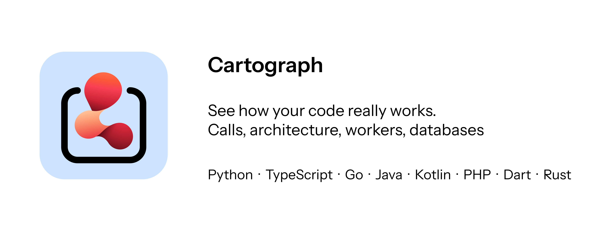

<p align="center"></p>

<p align="center">
  <a href="https://marketplace.visualstudio.com/items?itemName=drichdev.cartograph"></a>
  <a href="https://marketplace.visualstudio.com/items?itemName=drichdev.cartograph"></a>
  
  
</p>

 🇬🇧 Version English : [`README.fr.md`](README.fr.md) · 🇫🇷 française

# Cartograph

**Understand a project at a glance.** Cartograph draws the map of your code inside VS Code: who calls what, how layers talk to each other, and above all **how the project really runs** (routes, task queues, workers, Redis, databases).

It analyzes **Python, TypeScript/JavaScript, Go, Java, Kotlin, PHP, Dart (Flutter) and Rust**, merges everything, and even links your front end's `fetch` calls to your back end's routes.

> Everything stays on your machine: no telemetry, no code is sent anywhere. See [Privacy](#privacy).

## What you get

| View | What it is for |
|---|---|
| **System** | How it runs: processes → routes → queues (Celery, BullMQ…) → workers → Redis, MongoDB, SQL, APIs. Async dispatches are animated; front → back HTTP calls are linked. |
| **Architecture** | Modules arranged by layer (routes/UI → services → repositories → models → infra). A red arrow is an upward dependency. Circular imports are flagged. |
| **Calls** | The call graph. One click shows everything a function triggers **and** everything leading to it. Double-click opens the code. |
| **Data** | Models (Pydantic, Beanie, SQLAlchemy, Prisma, Mongoose, TypeORM, JPA, Eloquent…), relations, storage database, and the **real schema** of databases compared with your code. |
| **Changes** | Before / after a refactor: functions added, removed, moved, new dependencies, routes, issues introduced or resolved. |
| **Quality** | Security, errors, **dead code**, **duplicates**, complexity, architecture. |

Also: **PNG / SVG / Mermaid** export, interface in **English and French**, VS Code light/dark themes respected.

## Installation

- **From VS Code**: open the Extensions view, search for **Cartograph**, click *Install*.
- **From a file**: `code --install-extension cartograph-0.1.0.vsix`
- **From source**: see [`CONTRIBUTING.md`](CONTRIBUTING.md).

Requirements: VS Code ≥ 1.85. **Python ≥ 3.9** only if your project contains Python (no package to install). Nothing else.

## Quick start

1. Open your project folder.
2. `Ctrl+Shift+P` → **Cartograph: Open the project map** (or click *Cartograph* in the status bar).
3. Explore: click a node for details, double-click to open the code, use the search box at the top.

The analysis re-runs automatically on every save.

## Languages and frameworks

| Language | Analysis | Also recognized |
|---|---|---|
| **Python** | AST | FastAPI (`Depends`, `Annotated`), Flask, Celery/RQ/Dramatiq, SQLAlchemy, Pydantic, Beanie |
| **TypeScript / JavaScript** | TypeScript compiler | Next.js (app + pages), Express/Fastify/Hono, NestJS (`@Module`, interfaces), React, BullMQ, Prisma, Mongoose, TypeORM, zod |
| **Go** | tree-sitter | gin/echo/chi/mux/fiber, gorm, mongo-driver, go-redis, asynq, cron, google/wire |
| **Java** | tree-sitter | Spring (`@RestController`, `@Bean`, `@Scheduled`, `@KafkaListener`, `@PreAuthorize`), JPA, Redis, JDBC |
| **Kotlin** | tree-sitter | Spring, Ktor (`get("/x") { }`), JPA, Room |
| **PHP** | tree-sitter | Laravel (routes, groups, `Route::resource`, Eloquent, jobs), Symfony (`#[Route]`), Doctrine |
| **Dart / Flutter** | lightweight lexical analyzer¹ | widgets, `build`, GoRouter, Dio/http, sqflite, Hive, Firebase, Supabase |
| **Rust** | tree-sitter | axum, actix/rocket, sqlx/diesel, redis, reqwest, traits |

¹ No precompiled tree-sitter Dart grammar exists for WebAssembly: Dart is analyzed by a lexical analyzer (comments, strings, braces) plus patterns. It is slightly less precise than the others.

## What is detected

- **Dead code**: functions with no caller. Routes, tasks, handlers, tests and widget lifecycles are excluded; methods, decorated functions and public exports are flagged “maybe”.
- **Duplicates**: identical or very similar structure (≥ 85%), regardless of variable names.
- **Security**: dynamic code execution, shell commands, dynamically built SQL, hard-coded secrets, disabled TLS, unverified JWT, CORS `*`, unsafe deserialization, weak hashes, XSS, write routes with no apparent authentication.
- **Complexity**: cyclomatic complexity per function, overly long functions, too many arguments.
- **Infrastructure**: Redis, MongoDB, PostgreSQL, MySQL, SQLite, ORMs, Celery, BullMQ, Asynq, RabbitMQ, Kafka, S3, Elasticsearch, LLMs, SMTP, Stripe, Firebase, Supabase… + `docker-compose.yml` and `Procfile`.
- **Dependency injection**: FastAPI `Depends`, NestJS, Spring (`@Bean`), Go (`wire`), interfaces/traits: indirect calls are linked to implementations (“injection” label).

## Compare before / after a refactor

1. **Changes** tab → **Save current state**.
2. Refactor and save: the tab lists the differences, and affected functions carry a *new* / *changed* badge in the Calls view.
3. Or **Compare with Git…**: Cartograph analyzes the chosen revision (HEAD, branch, tag, commit) in a temporary `git worktree`, without touching your folder.

## Real database schema (optional)

- **SQLite**: the project's `.db` / `.sqlite` files are read automatically, read-only.
- **PostgreSQL / MongoDB**: opt in yourself with `cartograph.databases` (read-only, 5 s timeout). Requires `psycopg2` (or `psycopg`) / `pymongo` in your Python interpreter.

```json
"cartograph.databases": [
  { "name": "prod", "type": "mongodb",  "uri": "${env:MONGO_URL}" },
  { "name": "app",  "type": "postgres", "uri": "${env:DATABASE_URL}" }
]
```

Do not write a password in the settings: `${env:NAME}` is read from your environment variables.

## Commands

| Command | Purpose |
|---|---|
| `Cartograph: Open the project map` | Opens the map. |
| `Cartograph: Refresh the analysis` | Re-runs the analysis. |
| `Cartograph: Save the current state as a baseline` | Comparison point for the Changes tab. |
| `Cartograph: Compare with a Git revision…` | Compare with HEAD, a branch, a tag or a commit. |

## Settings

| Setting | Default | Purpose |
|---|---|---|
| `cartograph.language` | `auto` | Interface language: `auto` (follows VS Code), `fr` or `en`. |
| `cartograph.pythonPath` | *(empty)* | Python ≥ 3.9 interpreter. Empty = auto-detect. |
| `cartograph.exclude` | `[]` | Folders to ignore in addition to `.venv`, `node_modules`, `target`, `vendor`, `build`… |
| `cartograph.autoRefresh` | `true` | Re-run the analysis when a file is saved. |
| `cartograph.databases` | `[]` | Databases to read to show their real schema. |

## Privacy

- **No data leaves your machine**: the analysis is entirely local, the extension makes no network request and sends no telemetry.
- Databases are only read if **you** declare them, **read-only**. URIs are passed to the analyzer through an environment variable (never on the command line) and credentials are masked in the display.
- Git comparison uses a temporary `git worktree`, removed afterwards.
- Caches live in the extension's global storage folder (never inside your project).

## Troubleshooting

**“Python files could not be analyzed”** — open **View → Output → Cartograph**: the real error is there. Common causes: Python not found or < 3.9 (set `cartograph.pythonPath`). Since 0.1.0 the analyzer deletes and rebuilds its cache by itself if it is invalid, and skips a problematic file instead of aborting the whole analysis.

**The map is empty** — check that the folder contains code in a supported language, that it is not in `cartograph.exclude`, then click *Refresh*.

**Too many nodes, unreadable** — use the search box, or “Highlight” (dead code, security…), or untick *Tests* / *References*.

**Front → back links are missing** — they need a readable URL path (`fetch("/users/…")`). Fully dynamic URLs are not linked.

**PNG/SVG export is empty on a very large graph** — use the Mermaid export.

## Limitations

- Dynamic languages cannot be analyzed completely: the call graph is an **approximation**. Links inferred from a bare method name are marked “uncertain” (dashed, can be hidden).
- Go / Java / Kotlin / PHP / Rust / Dart: resolution relies on declared types, fields, parameters and imports, without full inference.
- TypeScript: without `node_modules`, infrastructure clients are recognized from imports only.

## Contributing, publishing

- Contributing, adding a language: [`CONTRIBUTING.md`](CONTRIBUTING.md), [`docs/ADD_A_LANGUAGE.md`](docs/ADD_A_LANGUAGE.md)
- Publishing the extension: [`docs/PUBLISHING.md`](docs/PUBLISHING.md)
- Release history: [`CHANGELOG.md`](CHANGELOG.md) · Security: [`SECURITY.md`](SECURITY.md)

## License

MIT © Drichdev
